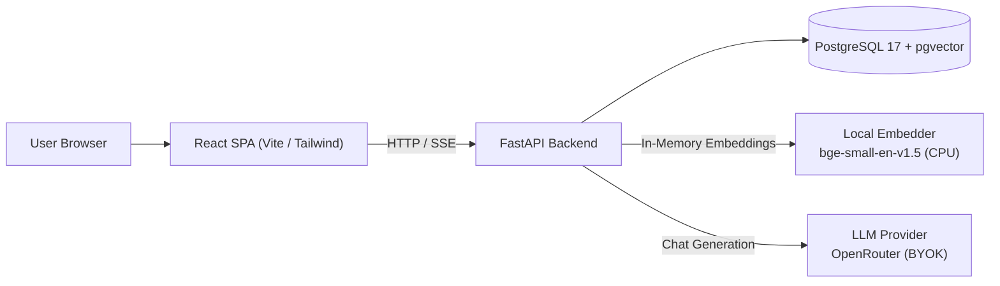

# RAGnarock

> A small, readable, open-source Retrieval-Augmented Generation (RAG) system built from scratch without black-box framework abstractions.

RAGnarock is designed as a complete, runnable full-stack application for developers learning how RAG systems work under the hood. It includes a FastAPI backend, a React frontend, local CPU embeddings, vector search via PostgreSQL with `pgvector`, and containerized deployment with Docker Compose.

---

## Architecture at a Glance



### Core Design Principles
- **Readable application code:** No LangChain, LlamaIndex, Celery, or Redis. The pipeline itself is the curriculum.
- **Postgres is the source of truth:** Chunks, metadata, and embeddings live in Postgres (`pgvector`). Vector indexes are derived and rebuildable.
- **Keyless local embeddings:** Embeddings are generated in-process on CPU using `BAAI/bge-small-en-v1.5` (384 dimensions). No embedding API keys or credits required.
- **BYOK (Bring Your Own Key) for generation:** LLM keys are supplied per request via the UI (`X-Provider-Key`), kept only in browser memory, and never persisted or logged by the server.

---

## Quickstart (Run Locally)

The only requirement is **Docker** and **Docker Compose**.

```bash
# 1. Clone the repository
git clone https://github.com/bit-nodedotai/RAGnarock.git
cd RAGnarock

# 2. Copy the environment template
cp .env.example .env

# 3. Start the stack
docker compose up --build
```

That's it!
- **Web App:** [http://localhost:5173](http://localhost:5173)
- **API Documentation:** [http://localhost:8000/api/docs](http://localhost:8000/api/docs)
- **API Health:** [http://localhost:8000/health](http://localhost:8000/health)

*(In local development, `AUTH_DISABLED=true` is enabled by default, so you can test document uploads and chat immediately without creating an account).*

---

## Native Development Setup

If you prefer running services directly on your host machine:

### Backend (Python 3.12 + `uv`)

```bash
cd backend
uv sync --extra dev          # Install dependencies into locked venv
uv run alembic upgrade head  # Run database migrations (requires running Postgres)
uv run pytest                # Run database-free unit test suite
uv run ruff check .          # Lint Python code
uv run ruff format --check . # Format verification
uv run mypy app              # Strict type checking
uv run uvicorn app.main:app --reload
```

### Frontend (React 19 + TypeScript + Vite)

```bash
cd frontend
npm ci                       # Install locked dependencies
npm run dev                  # Start Vite dev server on :5173
npm run lint                 # ESLint check
npm run typecheck            # TypeScript compiler check
npm test                     # Run Vitest test suite
npm run build                # Production asset build
```

---

## Tech Stack

| Component | Technology | Description |
| :--- | :--- | :--- |
| **Backend** | Python 3.12, FastAPI | Synchronous SQLAlchemy 2.x, psycopg 3, Pydantic v2 |
| **Vector DB** | PostgreSQL 17 + `pgvector` | HNSW cosine similarity index for chunk retrieval |
| **Embeddings** | `BAAI/bge-small-en-v1.5` | 384-dimension local CPU SentenceTransformer |
| **LLM Provider** | OpenRouter (BYOK) | Per-request model key with support for free `:free` models |
| **Frontend** | React 19, TypeScript, Vite | Tailwind CSS v4, TanStack Query, React Router |
| **Infrastructure** | Docker Compose, Caddy | Unified container configuration for local dev and production |

---

## Contributing

We welcome contributions! Please read our [CONTRIBUTING.md](CONTRIBUTING.md) guide and [docs/architecture.md](docs/architecture.md) before submitting pull requests.

Check out open issues tagged [`good first issue`](https://github.com/bit-nodedotai/RAGnarock/issues?q=is%3Aissue+is%3Aopen+label%3A%22good+first+issue%22) to get started!

---

## License

This project is licensed under the MIT License - see the [LICENSE](LICENSE) file for details.

