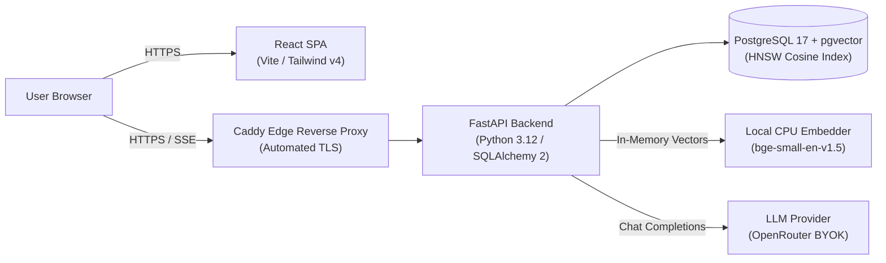

<div align="center">

# RAGnarock

**A small, readable, open-source Retrieval-Augmented Generation (RAG) system built from scratch without framework abstractions.**

[](LICENSE)
[](https://www.python.org/)
[](https://react.dev/)
[](https://www.typescriptlang.org/)
[](https://github.com/pgvector/pgvector)
[](CONTRIBUTING.md)
[](https://github.com/bit-nodedotai/RAGnarock/issues?q=is%3Aissue+is%3Aopen+label%3A%22good+first+issue%22)

<p align="center">
  <a href="#overview">Overview</a> •
  <a href="#key-features">Key Features</a> •
  <a href="#architecture">Architecture</a> •
  <a href="#quickstart">Quickstart</a> •
  <a href="#documentation">Documentation</a> •
  <a href="#contributing">Contributing</a>
</p>

</div>

---

## Overview

RAGnarock is an open-source, contributor-friendly Retrieval-Augmented Generation platform. Unlike tutorial notebooks or black-box framework wrappers (LangChain, LlamaIndex), RAGnarock is built as a **complete, inspectable, and runnable production system** — featuring a typed FastAPI backend, a modern React single-page application, local CPU embeddings, vector search via PostgreSQL with `pgvector`, and Docker containerization.

Designed specifically for developers and open-source contributors, the entire pipeline is implemented in pure Python and TypeScript so every piece of the RAG workflow is transparent and easy to extend.

---

## Key Features

- **Transparent Application Pipeline:** No opaque agent orchestrators or external vector brokers. The application code itself serves as the learning material.
- **Postgres as the Source of Truth:** Documents, parsed chunks, and 384-dimensional vector embeddings are stored directly in PostgreSQL with `pgvector` (HNSW indexing).
- **Keyless Server-Side Embeddings:** In-process CPU embeddings via `BAAI/bge-small-en-v1.5`. No embedding API tokens or credit card requirements to chunk and search documents.
- **BYOK (Bring Your Own Key) Generation:** Secure generation architecture where user keys (OpenRouter) are sent per-request in client headers (`X-Provider-Key`), kept in memory, and never persisted to databases or written to server logs.
- **Production-Ready Docker Stack:** Single unified Docker Compose configuration powering local hot-reloaded development as well as hardened production deployments with Caddy edge reverse proxying and automated Let's Encrypt TLS.

---

## Architecture



---

## Quickstart

### Prerequisites
- [Docker](https://docs.docker.com/get-docker/) & [Docker Compose](https://docs.docker.com/compose/)

### 1. Run with Docker Compose
```bash
# Clone the repository
git clone https://github.com/bit-nodedotai/RAGnarock.git
cd RAGnarock

# Copy environment variables
cp .env.example .env

# Start the full stack
docker compose up --build
```

### 2. Access the Application
- **Frontend Workspace:** [http://localhost:5173](http://localhost:5173)
- **Interactive OpenAPI Docs:** [http://localhost:8000/api/docs](http://localhost:8000/api/docs)
- **API Health Check:** [http://localhost:8000/health](http://localhost:8000/health)

*(In development, `AUTH_DISABLED=true` is enabled by default, auto-authenticating a local user so you can test document uploads and chat queries immediately).*

---

## Repository Structure

```text
RAGnarock/
├── backend/
│   ├── app/
│   │   ├── api/          # Route handlers (auth, documents, search, chat)
│   │   ├── core/         # Settings, logging redaction, and JWT security
│   │   ├── db/           # SQLAlchemy models (User, Document, Chunk) & sessions
│   │   ├── embeddings/   # Local bge-small and deterministic fake embedders
│   │   ├── ingestion/    # Document chunkers and background ingestion pipeline
│   │   ├── llm/          # OpenRouter BYOK and fake LLM providers
│   │   └── rag/          # pgvector retriever and citation prompt builder
│   ├── alembic/          # Database schema migrations
│   └── tests/            # Pytest test suite (DB-free unit tests)
├── frontend/
│   ├── src/
│   │   ├── api/          # Typed API client and generated schemas
│   │   ├── app/          # QueryClientProvider and React Router setup
│   │   ├── features/     # Auth, document library, and chat panels
│   │   └── pages/        # Workspace page view
├── infra/
│   ├── compose.yml       # Local development stack (db, api, web)
│   ├── compose.prod.yml  # Production deployment stack (db, api, edge)
│   ├── Caddyfile         # Reverse proxy, security headers, and automated TLS
│   └── Dockerfile        # Production multi-stage Caddy + SPA image
├── docs/                 # Architecture specifications and deployment guides
└── planning/             # Issue manifests and contributor roadmap
```

---

## Documentation

- **[docs/architecture.md](docs/architecture.md):** The authoritative technical specification and design invariants.
- **[docs/self_hosting.md](docs/self_hosting.md):** Production single-VM deployment and operations runbook.
- **[CONTRIBUTING.md](CONTRIBUTING.md):** Contributor guidelines, issue claiming rules, and PR checklists.
- **[SECURITY.md](SECURITY.md):** Security model, vulnerability reporting, and credential privacy guarantees.
- **[AGENTS.md](AGENTS.md):** Detailed technical instructions for AI pair-programming agents.

---

## Contributing

We welcome contributions from developers of all experience levels! Please review our [Contributing Guide](CONTRIBUTING.md) and [Code of Conduct](CODE_OF_CONDUCT.md).

To get started:
1. Browse issues tagged [`good first issue`](https://github.com/bit-nodedotai/RAGnarock/issues?q=is%3Aissue+is%3Aopen+label%3A%22good+first+issue%22).
2. Comment on the issue to request assignment.
3. Fork the repository, create your feature branch, and submit a pull request!

---

## License

This project is open-source and licensed under the terms of the [MIT License](LICENSE).
