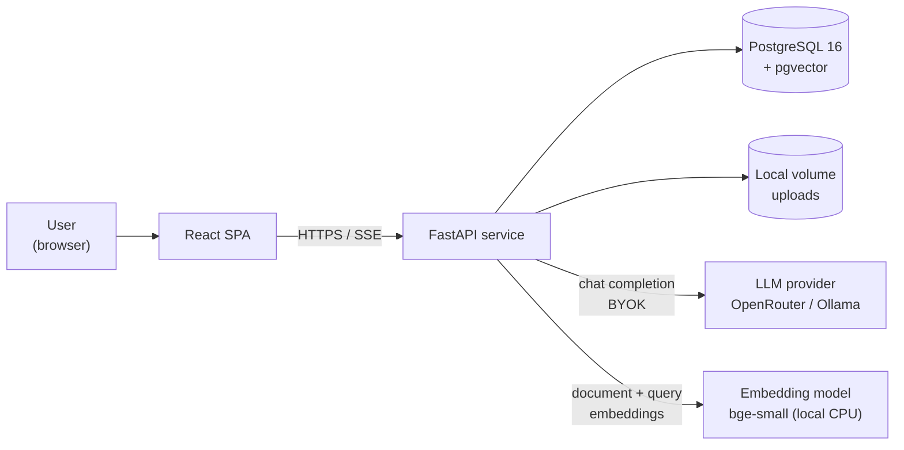
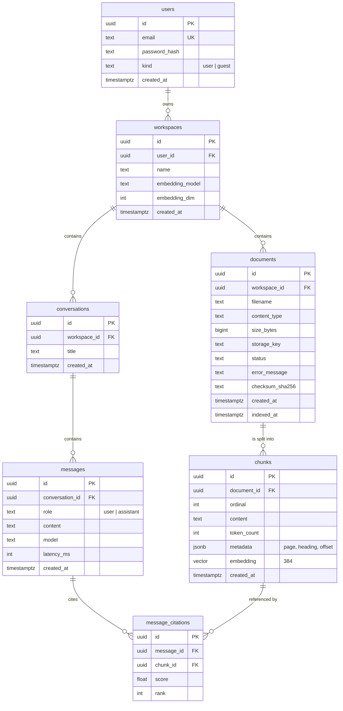
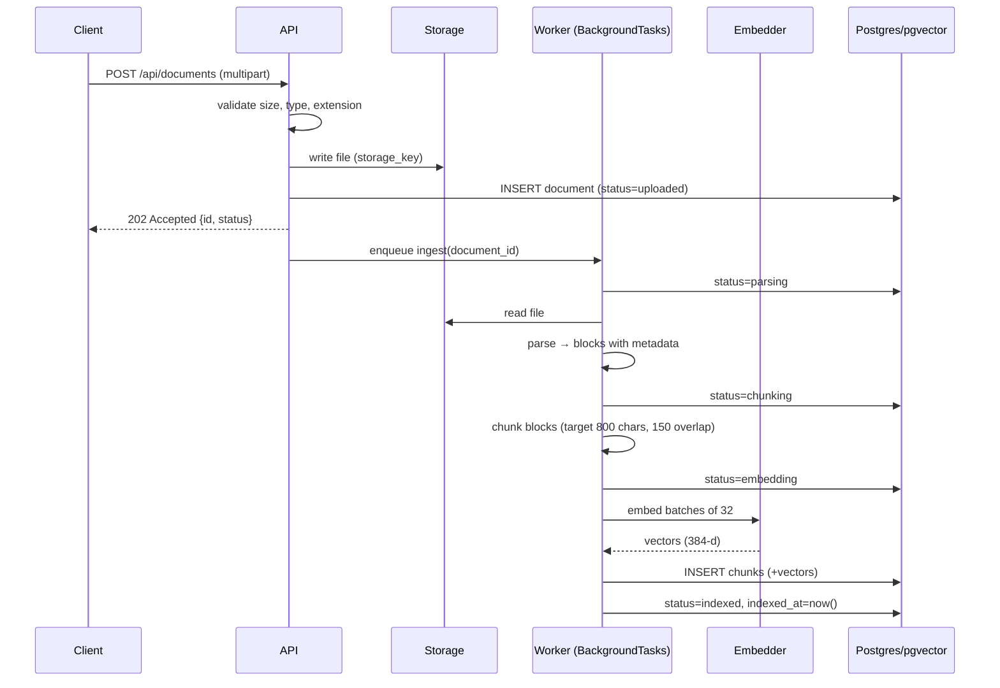
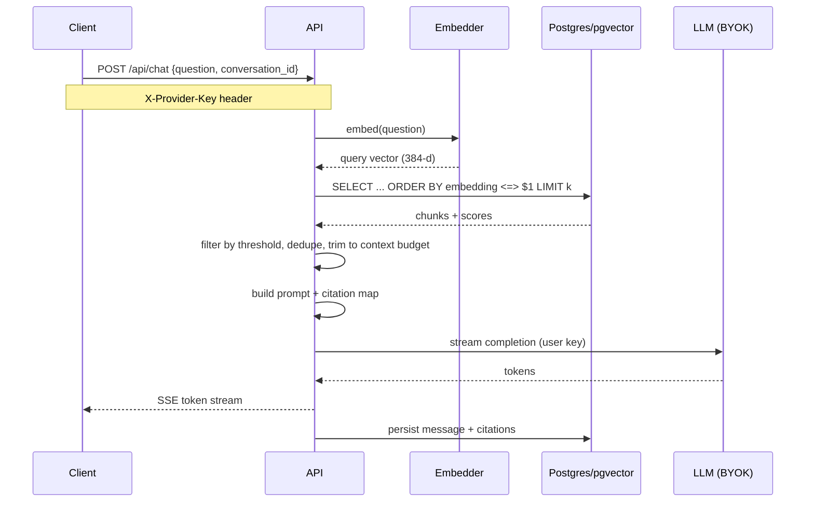

# RAGnarock — Architecture

| | |
|---|---|
| **Status** | Accepted |
| **Version** | 1.1 |
| **Date** | 2026-11-08 |
| **Maintainers** | NodeDotAI |
| **License** | MIT |

---

## Table of contents

1. [Purpose and scope](#1-purpose-and-scope)
2. [Goals and non-goals](#2-goals-and-non-goals)
3. [Design principles](#3-design-principles)
4. [System context](#4-system-context)
5. [Deployment topologies](#5-deployment-topologies)
6. [Component architecture](#6-component-architecture)
7. [Data model](#7-data-model)
8. [RAG pipeline](#8-rag-pipeline)
9. [Provider abstractions](#9-provider-abstractions)
10. [Credential and secret model](#10-credential-and-secret-model)
11. [API surface](#11-api-surface)
12. [Configuration reference](#12-configuration-reference)
13. [Security architecture](#13-security-architecture)
14. [Failure modes and degradation](#14-failure-modes-and-degradation)
15. [Performance targets](#15-performance-targets)
16. [Testing strategy](#16-testing-strategy)
17. [Observability](#17-observability)
18. [Repository layout](#18-repository-layout)
19. [Decision log](#19-decision-log)
20. [Roadmap](#20-roadmap)
21. [Open questions](#21-open-questions)

---

## 1. Purpose and scope

RAGnarock is an open-source, contributor-friendly Retrieval-Augmented Generation system. It is designed as a **complete, runnable application** — frontend, backend, database, ingestion pipeline, containerization, and CI — rather than a notebook or a framework demo.

The project serves two audiences simultaneously:

- **Learners.** Junior developers who should be able to understand and contribute to a real RAG implementation without wading through a framework.
- **Users.** Anyone who wants to upload their own documents and ask questions about them, either locally or through a public demo.

This document describes the architecture that both audiences run. There is **one codebase and one compose file**; local development and the hosted demo differ only in configuration.

---

## 2. Goals and non-goals

### 2.1 Goals

| ID | Goal |
|---|---|
| G1 | Clone-to-running in under 10 minutes with a single command. |
| G2 | A complete RAG pipeline — parse, chunk, embed, store, retrieve, generate with citations — implemented in readable application code. |
| G3 | 150+ contributors can work in parallel with minimal merge conflicts. |
| G4 | Green CI with **zero repository secrets** for contributors and fork PRs. |
| G5 | The full stack runs online on a single commodity VM, functionally, not as a static mock. |
| G6 | No vendor lock-in: every external dependency sits behind an interface. |
| G7 | User credentials are never persisted by the server. |

### 2.2 Non-goals (v0.1)

| ID | Non-goal | Rationale |
|---|---|---|
| N1 | Multi-org tenancy, SSO, OAuth | Adds auth surface without teaching RAG. |
| N2 | Horizontal scaling | The reference deployment is a single node. |
| N3 | GPU inference | Code must run on CPU-only infrastructure. |
| N4 | Agentic tool use, web browsing | Out of scope until retrieval quality is solved. |
| N5 | Cloud-managed parsers, OCR APIs, managed vector databases | Incompatible with the credential model (§10). |
| N6 | Framework orchestration (LangChain, LlamaIndex) | The pipeline is the curriculum. |

---

## 3. Design principles

1. **Postgres is the source of truth.** Documents, chunk text, metadata, and pipeline state live in Postgres. The vector index is derived data and can always be rebuilt.
2. **Derived state is disposable.** Any index, cache, or artifact can be regenerated from the database with `just reindex`.
3. **Credentials flow inward, never outward.** Model keys are supplied per request and discarded. Nothing is written to logs, the database, or error trackers.
4. **Interfaces at every boundary.** `VectorStore`, `StorageBackend`, `EmbeddingProvider`, `LLMProvider`, `Parser`, `Chunker`. Swapping an implementation is a configuration change.
5. **Keyless by default.** The application is useful before the user supplies any credential.
6. **One artifact, two environments.** Local and production use the same image and the same compose file.
7. **Small files, single responsibility.** One route module, parser, or component per file — this is what makes atomic issue decomposition possible.

---

## 4. System context



The embedding model is **in-process** and server-owned. The LLM provider is **remote and user-owned**. This asymmetry is deliberate and is explained in §10.

---

## 5. Deployment topologies

RAGnarock supports exactly two environments:

| Environment | Orchestration | Runs on | Purpose |
|---|---|---|---|
| **Local** | Docker Compose | Each contributor's machine | Development, testing, personal use |
| **Hosted** | Docker Compose (`prod` profile) | A single AWS EC2 instance | The public demo linked from the README |

Both use the same image and the same compose file; only configuration differs. Provider-specific runbooks live in `infra/deploy/`; provisioning, credentials, and operational procedure are deliberately out of scope for this document.

### 5.1 Local development (primary)

Every contributor runs the entire stack on their own machine. There is no shared state between contributors.

```
┌─────────────────────── contributor laptop ───────────────────────┐
│                                                                  │
│  docker compose up                                               │
│  ├── web        (node)      :5173  ── HMR                        │
│  ├── api        (python)    :8000                                │
│  ├── db         (postgres)  :5432  [internal only]               │
│  └── ollama     (optional profile) :11434                        │
│                                                                  │
│  named volumes: rag_rock_pgdata, rag_rock_uploads                │
└──────────────────────────────────────────────────────────────────┘
```

Characteristics:

- Hot reload for both `web` and `api`.
- Postgres port is **not published** by default; it is reachable only inside the compose network. A `debug` profile publishes it for GUI clients.
- `LLM_PROVIDER=fake` makes the entire stack runnable with no external key.
- `AUTH_DISABLED=true` short-circuits authentication to a seeded local user.

### 5.2 Reference deployment (hosted demo)

The hosted site runs the same compose file with the `prod` profile on a single AWS EC2 instance.

```
Internet
   │
   ▼
Cloudflare DNS  ──►  EC2 Elastic IP (or Cloudflare Tunnel)
   │
   ▼
Caddy  (automatic TLS, same-origin reverse proxy)
   ├── /            → static React build
   ├── /api/*       → api:8000
   └── /health      → api:8000/health
   │
   ├── api        (python, keyless embeddings)
   ├── db         (postgres + pgvector, persistent volume)
   └── uploads    (persistent volume, nightly pg_dump + archive)
```

| Property | Value |
|---|---|
| Compute | AWS EC2 `t4g.medium` — Graviton (ARM64), 2 vCPU / 4 GB |
| Architecture | `linux/arm64` |
| Storage | 30 GB gp3 root volume; persistent volumes for Postgres data and uploads |
| HTTPS | Caddy automatic certificates |
| Origin policy | Same-origin. No CORS configuration is required. |
| Availability monitoring | GitHub Actions cron polls `/health` every 6 hours |
| Durability | Nightly `pg_dump` + upload archive to object storage |
| Runbook | `infra/deploy/aws-ec2.md` |

Graviton is ARM64, so the hosted instance consumes the same `linux/arm64` images CI publishes. There is no separate build path for the public demo.

**Why a single VM rather than a serverless platform.** Serving the SPA and the API from one origin eliminates CORS and cross-site cookie handling. Self-hosting Postgres removes the need for a second managed dependency. Most importantly, the deployment is the *same* compose file contributors run, so there is no second runtime shape to maintain and no class of "works locally, broken in prod" defects.

### 5.3 Alternative: managed backend

If a single VM is unsuitable, the stack maps onto a managed platform without application changes:

| Concern | Reference | Alternative |
|---|---|---|
| Compute | AWS EC2 + compose | Managed container platform (e.g. Cloud Run, ECS Fargate) |
| Database | Self-hosted Postgres | Managed PostgreSQL with pgvector (e.g. Neon, RDS) |
| Storage | Local volume | S3-compatible object storage |
| Frontend | Caddy, same origin | Static host (e.g. Cloudflare Pages) with CORS enabled |

This path is supported by the interfaces in §9 and requires no application code changes.

---

## 6. Component architecture

### 6.1 Frontend

**React 19 + TypeScript + Vite + Tailwind CSS.**

| Concern | Choice |
|---|---|
| Data fetching | TanStack Query |
| Routing | React Router |
| API client | Generated from the FastAPI OpenAPI schema |
| Streaming | `fetch` + `ReadableStream` over Server-Sent Events |
| Component tests | Vitest + Testing Library |
| End-to-end | Playwright |

The generated client is a hard requirement: it allows frontend and backend contributors to work in parallel without coordinating on request shapes.

Key screens: document library with ingestion status, chat with streamed answers and inline citations, a sources panel, and a **retrieval inspector** that exposes top-k chunks, similarity scores, and context-budget trimming for the last query.

### 6.2 Backend

**Python 3.12 + FastAPI.**

| Concern | Choice | Note |
|---|---|---|
| ORM | SQLAlchemy 2.0, **synchronous** | Simpler for contributors; blocking work runs in a thread pool |
| Driver | psycopg 3 | |
| Migrations | Alembic | Required from the first commit |
| Validation | Pydantic v2 | |
| Settings | pydantic-settings | 12-factor, `.env` driven |
| Background work | FastAPI `BackgroundTasks` + status column | No broker in v0.1 |
| Logging | `structlog`, JSON in prod | Redaction filter installed at startup |

Synchronous SQLAlchemy is an intentional trade-off. The workload is I/O bound on the database and CPU bound on embeddings, and async sessions are a common source of silent bugs for new contributors. Blocking calls (embedding, parsing) are dispatched to a worker thread.

### 6.3 Background ingestion

Ingestion is a job with explicit, observable states rather than a synchronous request:

```
uploaded → parsing → chunking → embedding → indexed
                                      └──► failed (error_message)
```

The frontend polls `GET /documents/{id}` and renders status. `BackgroundTasks` is documented as single-process and non-durable; the `JobQueue` interface leaves room for Arq, Dramatiq, or Celery in a later release without touching call sites.

**Why not a broker in v0.1:** Redis and a worker container triple the setup surface for contributors and add two more failure modes to the demo, for a workload that a single node handles comfortably.

---

## 7. Data model



### 7.1 Notes

- **Chunk text lives in Postgres, not only in the vector index.** Citations are rendered without a vector-store round trip, and the index is fully rebuildable.
- `chunks.embedding` is `vector(384)` with an HNSW index using cosine distance. The dimension is fixed by `EMBEDDING_MODEL`; a mismatch is a startup error, not a runtime surprise.
- `workspaces.embedding_model` is written at creation. Mixing models within a workspace is rejected.
- `users.kind = 'guest'` supports anonymous demo sessions with a TTL purge (§13.4).
- `documents.checksum_sha256` enables idempotent re-upload and duplicate detection.

### 7.2 Indexing

| Index | Purpose |
|---|---|
| `chunks USING hnsw (embedding vector_cosine_ops)` | Approximate nearest neighbour search |
| `chunks (document_id)` | Citation joins, document deletion |
| `documents (workspace_id, status)` | Library listing, status polling |
| `documents (checksum_sha256)` | Duplicate detection |
| `users (email)` unique | Authentication |

---

## 8. RAG pipeline

### 8.1 Ingestion



Failure at any stage sets `status=failed` and stores a bounded `error_message`. Partial chunks are deleted before the failure is recorded, so `indexed` always means fully indexed.

### 8.2 Query



### 8.3 Parameters (defaults)

| Parameter | Default | Rationale |
|---|---|---|
| Chunk size | 800 characters | Fits a paragraph; leaves room for several chunks in context |
| Chunk overlap | 150 characters | Preserves sentence continuity across boundaries |
| Top-k retrieved | 8 | Balances recall against context cost |
| Minimum score | 0.30 cosine similarity | Filters clearly irrelevant chunks |
| Context budget | 6,000 tokens | Leaves headroom in most mid-size model contexts |
| Retrieved chunks in prompt | ≤ 8, ranked by score | Deterministic ordering for reproducible citations |

### 8.4 Prompting

The prompt is assembled in code, not in a template language, so contributors can read it end to end. It contains: a system instruction to answer only from context, numbered context blocks with document and page metadata, the user question, and an instruction to cite block numbers. Citations returned by the model are mapped back to `chunk_id` and persisted.

If retrieval yields nothing above the threshold, the API returns a grounded "not found in your documents" response without calling the LLM.

---

## 9. Provider abstractions

Every boundary is a small Protocol (or abstract base class) with at least two implementations: a real one and a fake.

```python
class EmbeddingProvider(Protocol):
    model: str
    dim: int
    def embed_documents(self, texts: list[str]) -> list[list[float]]: ...
    def embed_query(self, text: str) -> list[float]: ...

class LLMProvider(Protocol):
    def stream(
        self,
        messages: list[Message],
        *,
        temperature: float = 0.2,
    ) -> Iterator[Token]: ...

class VectorStore(Protocol):
    def upsert(self, chunks: list[ChunkRecord]) -> None: ...
    def search(self, vector: list[float], *, k: int, filters: Filters) -> list[ScoredChunk]: ...
    def delete_by_document(self, document_id: UUID) -> None: ...

class StorageBackend(Protocol):
    def put(self, key: str, data: BinaryIO) -> None: ...
    def get(self, key: str) -> BinaryIO: ...
    def delete(self, key: str) -> None: ...

class Parser(Protocol):
    supported_types: frozenset[str]
    def parse(self, data: BinaryIO) -> list[Block]: ...

class Chunker(Protocol):
    def chunk(self, blocks: list[Block]) -> list[Chunk]: ...
```

### 9.1 Implementations

| Interface | v0.1 | Later |
|---|---|---|
| `EmbeddingProvider` | `local` (sentence-transformers, CPU), `fake` | `openrouter`, `ollama` |
| `LLMProvider` | `openrouter`, `ollama`, `fake` | OpenAI-compatible, Gemini |
| `VectorStore` | `pgvector` | `qdrant` |
| `StorageBackend` | `local` | `s3` |
| `Parser` | `pdf`, `docx`, `markdown`, `text`, `html` | `csv`, `pptx`, `epub` |
| `Chunker` | `recursive`, `markdown` | `single`, `semantic` |
| `JobQueue` | `background_tasks` | `arq`, `dramatiq` |

### 9.2 Dependency shapes

The two credential models produce two different dependency shapes, and the asymmetry is enforced by types:

```python
# Server-owned singleton. No request context. Never accepts a credential.
def get_embedder() -> EmbeddingProvider: ...

# Request-scoped, credential-aware.
async def get_llm(request: Request) -> LLMProvider: ...
```

`get_embedder()` is module-scoped and loaded once at startup. It takes no `Request`. This is the single most important structural invariant in the codebase: it makes it impossible to accidentally pipe a user credential into the embedding path, and thereby impossible to index documents with a model the query path cannot reproduce.

---

## 10. Credential and secret model

### 10.1 The rule

> **If a step runs outside an HTTP request, it can never be BYOK.**

Ingestion runs after the upload response has returned, in a background task. There is no request to carry a key. Therefore every stage on the ingestion path must have a keyless, server-owned implementation.

A second constraint forces the same conclusion: query embeddings must come from the **same model** as document embeddings. Different models mean different dimensions and different vector spaces, so cross-model similarity is meaningless. A per-user embedding model would invalidate the index for every user.

### 10.2 Three credential tiers

| Tier | Definition | Applies to |
|---|---|---|
| **0 — keyless** | No credential of any kind | Parsing, chunking, embeddings, pgvector, prompt assembly, auth |
| **1 — BYOK** | Supplied by the user per request, used, discarded | Chat completion; later, reranking and web search |
| **2 — infrastructure** | Held by maintainers, in environment or CI secrets | SSH deploy key, Cloudflare token, backup target, GHCR |

There is **no tier for a maintainer-held model key.** RAGnarock never ships or stores a model provider key.

### 10.3 BYOK flow

```
Browser                         API                          Provider
  │                              │                              │
  │  POST /api/chat              │                              │
  │  X-Provider-Key: sk-or-...   │                              │
  ├─────────────────────────────►│                              │
  │                              │  read header                 │
  │                              │  build provider (ephemeral)  │
  │                              ├─────────────────────────────►│
  │                              │◄────── token stream ─────────┤
  │◄───── SSE tokens ────────────┤                              │
  │                              │  discard key                 │
  │                              │  never persist, never log    │
```

| Property | Implementation |
|---|---|
| Storage | `sessionStorage` in the browser; cleared when the tab closes |
| Transport | HTTPS only, custom header — never a query parameter |
| Server handling | Request-scoped only; not cached, not queued, not stored |
| Logging | Redaction filter strips `authorization` and `x-provider-key` |
| Error surfaces | Key never appears in responses, stack traces, or telemetry |
| Verification | A canary test asserts the key appears in zero log records (§16) |

### 10.4 Consequences

The credential model forbids a class of dependencies. These are **rejected by design**, not merely deferred:

- Cloud document parsers and OCR APIs (ingestion path, keyed).
- Managed vector databases (ingestion path, keyed).
- Hosted rerankers used during ingestion.
- Any provider-side feature requiring a server-held model key.

If scanned-PDF support is required, it is provided by a local OCR engine (Tesseract or Docling), not a hosted API.

---

## 11. API surface

Base path: `/api`. All endpoints are versioned implicitly by the application release; the OpenAPI schema is the contract.

| Method | Path | Auth | Key | Description |
|---|---|---|---|---|
| `GET` | `/health` | none | none | Liveness + DB readiness |
| `GET` | `/version` | none | none | Build SHA, model names |
| `POST` | `/auth/register` | none | none | Create account |
| `POST` | `/auth/login` | none | none | JWT pair |
| `POST` | `/auth/refresh` | none | none | Rotate access token |
| `GET` | `/auth/me` | JWT | none | Current user |
| `GET` | `/workspaces` | JWT | none | List workspaces |
| `POST` | `/workspaces` | JWT | none | Create workspace |
| `POST` | `/documents` | JWT | none | Multipart upload → `202` |
| `GET` | `/documents` | JWT | none | List with status |
| `GET` | `/documents/{id}` | JWT | none | Detail + status |
| `DELETE` | `/documents/{id}` | JWT | none | Cascade delete chunks |
| `GET` | `/documents/{id}/chunks` | JWT | none | Chunk inspector |
| `POST` | `/documents/{id}/reindex` | JWT | none | Re-run ingestion |
| `POST` | `/search` | JWT | none | Retrieval-only, no generation |
| `POST` | `/chat` | JWT | **BYOK** | SSE token stream |
| `GET` | `/conversations` | JWT | none | List |
| `GET` | `/conversations/{id}` | JWT | none | Messages + citations |

Notes:

- `POST /search` returns ranked chunks and scores without generation. It powers the retrieval inspector, works without a key, and is the primary tool for debugging retrieval quality.
- `POST /chat` returns `401` with an explicit `provider_key_required` error code when no key is supplied, and the frontend renders guidance rather than a generic failure.
- Errors follow a single envelope: `{ "error": { "code": str, "message": str, "details": object | null } }`.

---

## 12. Configuration reference

All configuration is environment-based, validated at startup by pydantic-settings, and documented in `.env.example`. Invalid configuration fails fast with an actionable message.

### 12.1 Core

| Variable | Default | Description |
|---|---|---|
| `APP_ENV` | `development` | `development` \| `production` \| `test` |
| `API_BASE_URL` | `http://localhost:8000` | Public base URL |
| `LOG_LEVEL` | `INFO` | |
| `LOG_FORMAT` | `console` | `console` \| `json` |

### 12.2 Database

| Variable | Default | Description |
|---|---|---|
| `DATABASE_URL` | `postgresql+psycopg://ragnarock:ragnarock@db:5432/ragnarock` | Must not point at a remote host outside the demo |

### 12.3 Storage

| Variable | Default | Description |
|---|---|---|
| `STORAGE_BACKEND` | `local` | `local` \| `s3` |
| `STORAGE_PATH` | `/data/uploads` | Used when `local` |
| `MAX_UPLOAD_MB` | `10` | Enforced before reading the body |
| `ALLOWED_MIME_TYPES` | `application/pdf,text/plain,text/markdown,text/html,application/vnd.openxmlformats-officedocument.wordprocessingml.document` | |

### 12.4 Embeddings

| Variable | Default | Description |
|---|---|---|
| `EMBEDDING_PROVIDER` | `local` | `local` \| `openrouter` \| `fake` |
| `EMBEDDING_MODEL` | `BAAI/bge-small-en-v1.5` | 384 dimensions |
| `EMBEDDING_DIM` | `384` | Validated against the loaded model |
| `EMBEDDING_BATCH_SIZE` | `32` | |

### 12.5 Generation

| Variable | Default | Description |
|---|---|---|
| `LLM_PROVIDER` | `openrouter` | `openrouter` \| `ollama` \| `fake` |
| `LLM_MODEL` | `openrouter/auto` | |
| `LLM_TEMPERATURE` | `0.2` | |
| `OPENROUTER_BASE_URL` | `https://openrouter.ai/api/v1` | |
| `OLLAMA_BASE_URL` | `http://ollama:11434` | |
| `ALLOW_SERVER_LLM_KEY` | `false` | Enables a server-side key for the demo only |

### 12.6 Retrieval

| Variable | Default | Description |
|---|---|---|
| `RETRIEVAL_TOP_K` | `8` | |
| `RETRIEVAL_MIN_SCORE` | `0.30` | |
| `CONTEXT_MAX_TOKENS` | `6000` | |

### 12.7 Auth and sessions

| Variable | Default | Description |
|---|---|---|
| `AUTH_DISABLED` | `true` | Local development only |
| `JWT_SECRET` | — | Required when `AUTH_DISABLED=false` |
| `JWT_EXPIRE_MINUTES` | `60` | |
| `GUEST_SESSION_TTL_HOURS` | `168` | 7-day purge window |
| `MAX_DOCS_PER_SESSION` | `5` | |

### 12.8 Rate limiting

| Variable | Default | Description |
|---|---|---|
| `RATE_LIMIT_CHAT_PER_MIN` | `10` | Per session |
| `RATE_LIMIT_UPLOAD_PER_MIN` | `3` | Per session |

---

## 13. Security architecture

### 13.1 Credential handling

- Redaction filter installed on the root logger at startup, before any handler is attached.
- Access log middleware strips `authorization`, `x-provider-key`, and `cookie` before emission.
- Caddy is configured **not** to log request headers.
- No telemetry SDK is enabled by default; if added, `send_default_pii=false` and breadcrumbs disabled.
- Canary test: a request carrying a known sentinel key must produce zero matching log records.

### 13.2 Upload handling

- Size limit enforced before the body is read.
- MIME type and extension both validated; the parser is selected by content type, not filename alone.
- Storage keys are generated server-side UUIDs; user-supplied filenames are never used as paths (prevents traversal).
- Parsing runs in a worker thread with a per-document timeout.
- Archive bombs and deeply nested structures are rejected at the parser boundary.

### 13.3 Authentication

- Argon2id password hashing.
- Short-lived access tokens, rotating refresh tokens.
- All resource queries scoped by `workspace.user_id`; ownership is enforced in the repository layer, not the route handler.
- `AUTH_DISABLED=true` is rejected when `APP_ENV=production`.

### 13.4 Guest sessions (public demo)

- First visit issues an httpOnly, `SameSite=Lax`, `Secure` session cookie (same-origin, so no cross-site configuration is needed).
- A synthetic `users` row with `kind='guest'` and one workspace is created per session.
- Nightly job purges guest users, and cascades remove documents, chunks, and uploads.
- The UI states plainly that uploads are stored on the demo server and deleted after 7 days.

### 13.5 Application

- CSP, `X-Content-Type-Options: nosniff`, `Referrer-Policy: no-referrer`, HSTS.
- Server-side rate limits on chat and upload per session, in addition to any edge limiting.
- Dependency and container scanning in CI.
- Branch protection with required checks; no direct pushes to `main`.

---

## 14. Failure modes and degradation

| Condition | Behaviour | User-visible result |
|---|---|---|
| No `X-Provider-Key` on `/chat` | No provider call | `401 provider_key_required` with setup guidance |
| Provider returns 429 | Pass through `Retry-After` | "Rate limited, retry in Ns" |
| Provider returns 5xx | One retry with jitter, then fail | `502 provider_unavailable` |
| Key rejected (401 from provider) | Do not retry | `401 invalid_provider_key` with "check your key" |
| Retrieval returns nothing above threshold | Skip LLM call entirely | Grounded "not found in your documents" |
| Embedding model dimension ≠ config | Startup fails | Container exits with explicit message |
| Postgres unavailable | Healthcheck fails, `503` | "Service unavailable" |
| Upload exceeds limit | Rejected before read | `413 payload_too_large` |
| Parse timeout | Job fails, partial chunks removed | Document shows `failed` with reason |
| Provider slow / stream stalls | Idle timeout, SSE closed | Partial answer retained, marked incomplete |
| Guest TTL expired | Session recreated empty | No data loss for the user; demo resets |

**Principle:** degraded behaviour is always *legible*. No endpoint returns a bare 500 when a specific, actionable error exists.

---

## 15. Performance targets

Measured on the reference 2-vCPU ARM VM.

| Metric | Target |
|---|---|
| Cold start (container → first request served) | < 10 s |
| Embedding model load (once, at startup) | < 8 s |
| Chunk embedding throughput | ≥ 40 chunks/s |
| Ingestion, 20-page PDF | < 25 s |
| Retrieval latency (p95, 10k chunks) | < 150 ms |
| Time to first token | < 2 s (provider-dependent) |
| Frontend initial load (gzipped) | < 250 KB |

Retrieval performance relies on the HNSW index; without it, brute-force cosine scan dominates at roughly 10k chunks.

---

## 16. Testing strategy

| Layer | Tool | Scope | Runtime |
|---|---|---|---|
| Unit | pytest | Parsers, chunkers, prompt assembly, redaction, config validation | < 10 s |
| Integration | pytest + compose Postgres | Repositories, migrations, pgvector search | < 60 s |
| Contract | pytest + OpenAPI snapshot | Request/response schema stability | < 5 s |
| Frontend unit | Vitest + Testing Library | Components, hooks, formatting | < 30 s |
| End-to-end | Playwright | Upload → index → ask → citations | < 3 min |
| Canary | pytest | Credentials never appear in logs | < 1 s |

### 16.1 Fake providers

`LLM_PROVIDER=fake` and `EMBEDDING_PROVIDER=fake` are first-class, not test-only hacks:

- Deterministic, hash-based embeddings with the correct dimension (stable ordering in tests).
- Scriptable LLM responses, including streaming and citations.
- Enable **zero-secret CI**, so fork PRs and first-time contributors run the full suite without configuration.

This is the property that makes 150 contributors tractable: no contributor needs a credential to get a green build.

### 16.2 Migration discipline

CI asserts that:

- `alembic heads` returns exactly one head.
- `alembic upgrade head` succeeds from an empty database.
- `downgrade -1 && upgrade head` round-trips.

---

## 17. Observability

| Concern | v0.1 |
|---|---|
| Logging | Structured JSON, request ID propagated from `X-Request-ID` or generated |
| Metrics | `/health` and `/version`; no metrics backend |
| Tracing | Disabled by default; OpenTelemetry stub behind a flag |
| RAG inspection | `GET /documents/{id}/chunks` and `POST /search` are the debugging surface |

The retrieval endpoints double as the observability story: they expose exactly what the pipeline saw, without a separate tracing stack. Adding a hosted tracing backend later is a provider behind a flag, not an architectural change.

---

## 18. Repository layout

```
ragnarock/
├── .github/
│   ├── workflows/          ci-api.yml, ci-web.yml, docker.yml, nightly.yml
│   ├── ISSUE_TEMPLATE/
│   └── CODEOWNERS
├── backend/
│   ├── app/
│   │   ├── main.py
│   │   ├── api/
│   │   │   ├── deps.py
│   │   │   ├── errors.py
│   │   │   └── routes/     auth.py, documents.py, chat.py, search.py,
│   │   │                   conversations.py, workspaces.py, health.py
│   │   ├── core/           config.py, security.py, logging.py, redaction.py
│   │   ├── db/             session.py, base.py, models/, repositories/
│   │   ├── parsers/        base.py, pdf.py, docx.py, markdown.py, text.py,
│   │   │                   html.py, registry.py
│   │   ├── chunking/       base.py, recursive.py, markdown.py, registry.py
│   │   ├── embeddings/     base.py, local.py, openrouter.py, fake.py
│   │   ├── llm/            base.py, openrouter.py, ollama.py, fake.py
│   │   ├── vector/         base.py, pgvector.py
│   │   ├── storage/        base.py, local.py, s3.py
│   │   ├── ingestion/      pipeline.py, jobs.py, status.py
│   │   ├── rag/            retriever.py, context.py, prompt.py, citations.py
│   │   └── schemas/
│   ├── alembic/versions/
│   ├── tests/              unit/, integration/, e2e/, canary/
│   ├── Dockerfile
│   └── pyproject.toml
├── frontend/
│   ├── src/
│   │   ├── app/            router.tsx, providers.tsx
│   │   ├── api/            generated/, client.ts, streaming.ts
│   │   ├── components/     ui/, chat/, documents/, sources/
│   │   ├── features/       chat/, documents/, settings/
│   │   ├── hooks/
│   │   ├── lib/
│   │   └── pages/
│   ├── tests/
│   ├── Dockerfile
│   └── package.json
├── infra/
│   ├── compose.yml         # base: db, api, web
│   ├── compose.prod.yml    # prod profile: + caddy
│   ├── Caddyfile
│   └── deploy/             aws-ec2.md, cloud-run.md
├── planning/
│   └── issues.yml          # issue manifest → scripts/publish_issues.py
├── scripts/                publish_issues.py, seed.py, backup.sh
├── docs/                   architecture.md, adr/, onboarding/
├── justfile
├── docker-compose.yml → infra/compose.yml
├── .env.example
├── CONTRIBUTING.md
├── CODE_OF_CONDUCT.md
└── LICENSE
```

The layout is deliberately flat rather than a monorepo workspace. Two applications, one infra directory, no workspace tooling to explain.

---

## 19. Decision log

| # | Decision | Alternatives considered | Rationale | Consequence |
|---|---|---|---|---|
| D1 | Postgres is the source of truth; vectors are derived | Qdrant as primary store | Index is rebuildable; citations need text anyway; one backup story | Re-embedding costs on model change |
| D2 | pgvector in v0.1, Qdrant in v0.2 | Qdrant from day one | One datastore for contributors; faster onboarding | `VectorStore` interface required from day one |
| D3 | Local embeddings (bge-small, CPU) | Remote embeddings via OpenRouter | Keyless ingestion; identical doc/query model; works with no account | CPU cost on the reference VM; fixed 384 dimensions |
| D4 | BYOK for generation only | Server-held key; server-side encrypted key storage | No key liability; no shared credential to abuse; aligns with open-source norms | First-time demo visitor cannot generate without a key |
| D5 | Synchronous SQLAlchemy | Async SQLAlchemy | Fewer concurrency bugs for contributors | Blocking work must be threaded explicitly |
| D6 | `BackgroundTasks` for ingestion | Celery, Arq, Dramatiq | No broker, no extra container | Not durable; documented; `JobQueue` interface reserved |
| D7 | Single AWS EC2 Graviton VM reference deployment | Managed container platform + managed Postgres | Dev/prod parity, same-origin, no CORS, one compose file, same ARM64 images as CI | Single point of failure; manual ops |
| D8 | Frontend served same-origin by Caddy | Vercel/Cloudflare Pages | No CORS, no cross-site cookies, one TLS setup | No CDN; frontend rebuild deploys with the stack |
| D9 | Generated TypeScript client from OpenAPI | Hand-written client | Frontend and backend PRs never block each other | Requires schema stability in CI |
| D10 | No LangChain / LlamaIndex | Framework orchestration | The pipeline is the teaching material; stable dependencies | More code to own (~300 lines) |
| D11 | Fake providers as production code | Test-only mocks | Zero-secret CI; 150 contributors without credentials | Fake implementations must track real interfaces |
| D12 | Atomic issue decomposition with pre-written skipped tests | Contributors write tests and implementations | Tests become the specification; PRs are reviewable | ~40 hours of maintainer scaffolding per 150 issues |

---

## 20. Roadmap

### v0.1 — Walking skeleton

Document upload (PDF, DOCX, Markdown, text, HTML), ingestion with status, pgvector retrieval, streamed answers with citations, retrieval inspector, local auth, compose, CI, reference deployment.

### v0.2 — Retrieval quality

Qdrant as an alternative `VectorStore`. Hybrid search (Postgres `tsvector` + vectors) with reciprocal rank fusion. Local cross-encoder reranking. Chunking strategy selection per document.

### v0.3 — Evaluation

Golden-question fixtures, recall@k and answer-grounding metrics, a CI report on retrieval regressions. This is the feature that distinguishes a teaching repository from a demo.

### v0.4 — Scale and operations

Durable job queue, S3 storage backend, tracing backend, multi-workspace sharing.

---

## 21. Open questions

| # | Question | Owner | Blocks |
|---|---|---|---|
| Q1 | Does the public demo issue guest sessions or require email signup? | Maintainers | §13.4 |
| Q2 | Should a strictly rate-limited server key be offered for first-touch demos? | Maintainers | §10.2 |
| Q3 | Which default LLM model is used for the demo? | Maintainers | §12.5 |
| Q4 | Is a CDN worth adding for the SPA, or is same-origin sufficient? | Maintainers | §5.2 |
| Q5 | Backup retention window and restore-drill cadence | Maintainers | §5.2 |

---

*This document is the authoritative description of system structure. Changes to any decision marked Accepted require an ADR in `docs/adr/` before implementation.*
